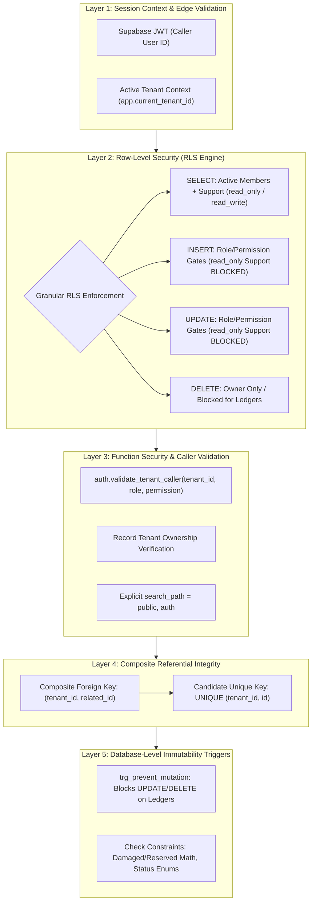

> **AUDIT HOLD — NOT PRODUCTION READY (2026-11-20):** This document describes the original implementation design and must be read alongside `AUDIT_REMEDIATION_STATUS.md`. The baseline audit reproduced critical authorization/RLS defects and workflow defects. The package has not been fully remediated or re-tested on PostgreSQL. Do not deploy based on this document alone.

# Mini ERP — Database Security & Tenancy Isolation Architecture

> **Target Platform**: Supabase / PostgreSQL 16  
> **Security Model**: Target design. See `SECURITY_RLS_REMEDIATION.md` for controls that exist and their verified limits.
> **Document Reference**: `docs/database/DATABASE_SECURITY.md`  

---

## 1. Multi-Tenant Isolation: Defense-in-Depth

The Mini ERP implements a **multi-layered security model** to guarantee tenant isolation and prevent cross-tenant data leakage or privilege escalation:

---

## 2. Granular RLS Policy Architecture (Operation Separation)

The previous generic `FOR ALL TO authenticated` model has been completely replaced with typed policies distinguishing `SELECT`, `INSERT`, `UPDATE`, and `DELETE`:

### 1. Administrative & Governance Domain
*(Tables: `tenant_settings`, `tenant_currencies`, `tenant_notification_rules`, `roles`, `tenant_memberships`, `membership_warehouse_access`, `tenant_invitations`)*
- **SELECT**: Accessible to all active members of the tenant, or platform staff with active support grants.
- **INSERT / UPDATE**: Restricted strictly to users holding the `'owner'` role or `'settings.manage'` permission. Ordinary employees cannot modify membership tiers, roles, or notification channels.
- **DELETE**: Restricted strictly to `'owner'`.

### 2. Operational Finance Domain
*(Tables: `order_cost_entries`, `order_refunds`, `order_profit_snapshots`, `expense_categories`, `expenses`, `settlements`, `settlement_items`, `supplier_payments`, `supplier_payment_allocations`)*
- **SELECT**: Restricted to users holding `'owner'`, `'accountant'`, or `'operations_manager'` roles, or active support grants. Ordinary warehouse staff cannot view financial records, profit margins, or courier settlements.
- **INSERT / UPDATE**: Restricted to `'owner'` and `'accountant'`. Read-only support agents cannot create or modify vouchers.
- **DELETE**: Financial ledgers cannot be deleted.

### 3. Operational Domain
*(Tables: `products`, `orders`, `warehouses`, `shipments`, etc.)*
- **SELECT**: Active tenant members or support grants.
- **INSERT / UPDATE**: Active members with operational permissions.
- **DELETE**: Restricted to `'owner'` or `'operations_manager'`.

### 4. Strictly Append-Only Domain
*(Tables: `inventory_transactions`, `order_status_history`, `shipment_tracking_events`, `audit_logs`, `sync_logs`, `variant_cost_history`)*
- **SELECT**: Active members or support grants.
- **INSERT**: Active members or background services.
- **UPDATE & DELETE**: **Zero RLS policies exist**. In addition, database triggers raise hard exceptions on any mutation attempt.

---

## 3. Support Access Scoping (`read_only` vs `read_write`)

The support-access architecture strictly enforces access levels:
- **`read_only` Grants**:
  - Validated via `auth.caller_has_support_access(tenant_id, 'read_only')`.
  - Permitted **only** on `SELECT` operations.
  - Denied on all `INSERT`, `UPDATE`, and `DELETE` operations.
- **`read_write` Grants**:
  - Validated via `auth.caller_has_support_access(tenant_id, 'read_write')`.
  - Allows troubleshooting write actions authorized by the grant.
- **Expiration & Revocation**:
  - Grants require `revoked_at IS NULL AND expires_at > clock_timestamp()`.
  - Check constraint enforces `expires_at <= granted_at + INTERVAL '24 hours'`. Expired grants immediately lose all access.

---

## 4. `SECURITY DEFINER` Function Hardening

Every `SECURITY DEFINER` function enforces caller validation:
1. **Caller Verification**: Calls `auth.validate_tenant_caller(p_tenant_id, role, permission)` to ensure the caller identity (`auth.uid()`) is non-null and belongs to `p_tenant_id`.
2. **Tenant Ownership Verification**: Validates that all passed entity IDs (`warehouse_id`, `variant_id`, `order_id`, `fulfillment_id`, `inspection_id`, `receipt_id`) belong to the target tenant before executing updates.
3. **Explicit Search Path**: Configured with `SET search_path = public, auth` to prevent search path hijacking.
4. **Execution Grants**: Execution rights are revoked from `PUBLIC` and `anon`, and granted only to `authenticated` and `service_role`.

---

## 5. Append-Only Record Protection & Immutability Triggers

Database-level triggers enforce immutability:
- **`prevent_immutable_record_mutation()`**: Trigger attached to `inventory_transactions`, `order_status_history`, `shipment_tracking_events`, `audit_logs`, `platform_audit_logs`, `sync_logs`, and `variant_cost_history`. Throws an exception on any `UPDATE` or `DELETE`.
- **`protect_order_profit_snapshots()`**: Attached to `order_profit_snapshots`. Prevents deletion and blocks modification of financial metrics (`gross_revenue`, `total_cogs`, `net_profit`), allowing only `is_latest` transition.
