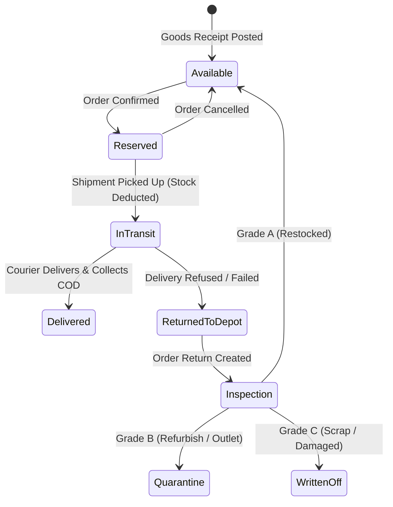

# Mini ERP — Master Architectural Blueprint & Schema Design

> **Status:** This is the target architecture and business-rule reference. It is not an implementation inventory. The repository currently contains 8 migrations and does not yet implement every workflow or control listed below; see `docs/architecture.md` and `docs/database/NEXT_STAGE_READINESS.md` for verified scope.

> **Target Industry**: Clothing & Fashion Brands  
> **Primary Currency**: Egyptian Pound (EGP)  
> **Architecture**: Multi-tenant shared PostgreSQL on Supabase with Row Level Security (RLS)  
> **Scope**: 74 tables across 11 functional modules  

---

## 1. Executive Architecture Overview

```mermaid
flowchart TD
    subgraph MultiTenantEdge ["Supabase Auth & Client Edge"]
        JWT["Supabase JWT (app_metadata / session claim)"]
        ClientApp["Next.js / TypeScript App"]
        ClientApp -->|Bearer Token + tenant_id header| PostgresEngine
    end

    subgraph PostgresEngine ["PostgreSQL 16 (Supabase)"]
        RLS["Row Level Security (RLS Engine)"]
        TenantCtx["app.current_tenant_id() Session Context"]
        
        subgraph CoreModules ["Tenant Data Isolation (All contain tenant_id)"]
            Catalog["Catalog & Variants (8 tables)"]
            Inventory["Inventory & Warehouses (6 tables)"]
            Orders["Orders & Fulfillment (9 tables)"]
            Purchasing["Purchasing & Suppliers (6 tables)"]
            Shipping["Shipping & Couriers (6 tables)"]
            Finance["Operational Finance (9 tables)"]
            Integrations["Integrations & Sync (9 tables)"]
        end

        subgraph SecurityModules ["Security & Platform Control"]
            Tenancy["Platform & Tenancy (7 tables)"]
            Users["Users & Permissions (7 tables)"]
            Audit["Audit & Sequences (4 tables)"]
        end

        RLS --> CoreModules
        TenantCtx --> RLS
    end
```

---

## 2. Multi-Tenancy & Security Foundations

### 2.1 Tenant Isolation Invariant
- **Rule**: Every tenant-owned table (`67` out of 74 tables) must contain `tenant_id uuid NOT NULL`.
- **Composite Foreign Keys**: Relationships between tenant-owned entities must enforce tenancy across foreign keys to guarantee referential integrity cannot jump tenant boundaries:
  ```sql
  CONSTRAINT fk_order_items_order 
    FOREIGN KEY (tenant_id, order_id) 
    REFERENCES orders(tenant_id, id) 
    ON DELETE RESTRICT
  ```
- **Composite Unique Constraints**: All entity keys, codes, SKUs, and sequences must be compound:
  ```sql
  UNIQUE (tenant_id, sku)
  UNIQUE (tenant_id, order_number)
  ```

### 2.2 RLS Helper Architecture
To prevent repetitive subqueries on `tenant_memberships` in every RLS policy, we utilize a security definer context helper:
```sql
CREATE OR REPLACE FUNCTION auth.current_tenant_id()
RETURNS uuid
LANGUAGE sql STABLE
AS $$
  SELECT NULLIF(current_setting('app.current_tenant_id', true), '')::uuid;
$$;
```
For Supabase Auth session evaluation:
```sql
CREATE POLICY tenant_isolation_policy ON orders
  FOR ALL
  USING (
    tenant_id = auth.current_tenant_id() 
    OR EXISTS (
      SELECT 1 FROM tenant_memberships tm
      WHERE tm.tenant_id = orders.tenant_id
        AND tm.user_id = auth.uid()
        AND tm.status = 'active'
    )
  );
```

### 2.3 Platform Administrators vs. Business Support
- `platform_admins` reside in an isolated table with zero implicit bypass of tenant RLS.
- Any troubleshooting of a tenant's database must pass through `support_access_grants`:
  - Granted by an active tenant administrator.
  - Time-bounded with explicit `expires_at`.
  - Every query and action is logged into `platform_audit_logs`.

---

## 3. Database Schema Catalog (74 Tables)

### Module 1: Platform & Tenancy (7 tables)
Global platform configuration, tenant registration, multi-currency settings, and support access.
1. `currencies`: Global currency definitions (ISO 4217: EGP, USD, EUR, SAR, AED).
2. `tenants`: Primary tenant registry (name, slug, status, subscription tier, default timezone).
3. `tenant_settings`: Key-value JSONB / typed settings (branding, return windows, COD fees).
4. `tenant_currencies`: Currencies enabled per tenant with exchange rates against base (EGP).
5. `platform_admins`: System-wide platform administrators (internal superusers).
6. `support_access_grants`: Time-limited, auditable grants allowing platform staff into a tenant.
7. `platform_audit_logs`: Append-only security log of cross-tenant and administrative actions.

### Module 2: Users & Permissions (7 tables)
User profiles linked to Supabase Auth, RBAC, and granular warehouse scoping.
8. `user_profiles`: Extends `auth.users` with display name, avatar, and global metadata.
9. `roles`: Tenant-level or system roles (e.g., Owner, Warehouse Manager, Order Dispatcher, Accountant).
10. `permissions`: Granular capability flags (e.g., `orders.view`, `inventory.adjust`, `finance.export`).
11. `role_permissions`: Mapping of roles to individual permissions.
12. `tenant_memberships`: User-to-tenant association with status (`active`, `suspended`, `invited`).
13. `membership_warehouse_access`: Restricts specific users to designated physical warehouses.
14. `tenant_invitations`: Email invitations with expiration tokens and pre-assigned roles.

### Module 3: Product Catalog (8 tables)
Fashion apparel hierarchy: categories, configurable variants (Size/Color), images, and cost tracking.
15. `product_categories`: Hierarchical category tree (Men > Tops > T-Shirts).
16. `products`: Master product envelope (name, base description, brand, season, status).
17. `product_images`: Multi-image management with variant associations and display orders.
18. `attribute_definitions`: Configurable attributes (e.g., "Color", "Size", "Fabric", "Fit").
19. `attribute_values`: Specific attribute values (e.g., "Navy Blue", "XL", "100% Cotton").
20. `product_variants`: Actual sellable SKUs with barcode, weight, retail price, and status.
21. `variant_attribute_values`: Junction assigning attributes to variants (SKU-TSHIRT-BLK-M -> Black + M).
22. `variant_cost_history`: Historical ledger of standard/estimated costs per variant over time.

### Module 4: Inventory & Warehouses (6 tables)
Append-only inventory ledger, derived balances, and inter-warehouse logistics.
23. `warehouses`: Physical and virtual stocking locations (e.g., Cairo Main, Alexandria Hub, Returns Depot).
24. `inventory_levels`: Derived real-time balances (`on_hand`, `reserved`, `available`, `damaged`).
25. `inventory_transactions`: Append-only ledger recording all stock movements (goods receipt, reserve, dispatch, adjustment).
26. `inventory_reservations`: Active holds against confirmed orders preventing overselling.
27. `warehouse_transfers`: Multi-warehouse replenishment and relocation manifests.
28. `warehouse_transfer_items`: Line-item details of stock in transit between locations.

### Module 5: Customers (3 tables)
Normalized customer identities tailored to Egyptian phone formatting and multi-channel reconciliation.
29. `customers`: Master customer identity with lifetime value, notes, and verification status.
30. `customer_identifiers`: Phone numbers (normalized E.164: +20...) and email addresses with verification flags.
31. `customer_addresses`: Multi-address book (governorate, city/district, street, landmarks, building/apt).

### Module 6: Orders & Fulfillments (9 tables)
Decoupled order state machine, partial dispatch, and return inspections.
32. `orders`: Master order record (order number, customer reference, sales channel, commercial totals).
33. `order_items`: Line items with snapshotted variant name, SKU, price, and snapshotted unit COGS.
34. `order_status_history`: Append-only tracking of status transitions (`draft`, `confirmed`, `processing`, `completed`, `cancelled`).
35. `order_payments`: Payment records decoupled from order status (Cash on Delivery, Gateway, InstaPay, Store Credit).
36. `order_fulfillments`: Discrete fulfillment packages (supports partial fulfillment across multiple batches).
37. `order_fulfillment_items`: Items packed in each fulfillment parcel.
38. `order_returns`: Initiated customer returns, exchanges, or courier-refused packages.
39. `order_return_items`: Specific items designated for return with declared reason codes.
40. `return_inspections`: Quality check records assigning returned items to restockable, defect, or scrap buckets.

### Module 7: Purchasing & Suppliers (6 tables)
Vendor management, purchase orders, and goods receiving.
41. `suppliers`: Manufacturer and raw material vendor records (textile mills, sewing workshops, packaging suppliers).
42. `supplier_contacts`: Key contacts per supplier.
43. `purchase_orders`: PO documents with target delivery dates, payment terms, and status.
44. `purchase_order_items`: PO line items detailing ordered quantities, unit costs, and tax.
45. `goods_receipts`: Dock receipts acknowledging delivered physical inventory batches.
46. `goods_receipt_items`: Line-level receipts comparing ordered vs. received quantities.

### Module 8: Shipping & Couriers (6 tables)
Egyptian courier integrations (e.g., Bosta, Mylerz, Aramex, Sprint) and tracking.
47. `couriers`: Courier service profiles with API integration configs and SLA rules.
48. `courier_service_areas`: Coverage matrix by Egyptian governorates/zones (Cairo, Giza, Delta, Upper Egypt, Red Sea).
49. `courier_pricing_rules`: Weight-based and zone-based shipping cost contracts.
50. `shipments`: Courier waybills, tracking numbers, shipping costs, and collected COD amounts.
51. `shipment_items`: Fulfillment items mapped into each specific shipment parcel.
52. `shipment_tracking_events`: Standardized event timeline (`picked_up`, `out_for_delivery`, `refused`, `delivered`).

### Module 9: Operational Finance & Settlements (9 tables)
Granular order profitability, courier COD settlements, and supplier balance ledgers.
53. `order_cost_entries`: Detailed breakdown of costs per order (courier fee, packaging, merchant gateway fee, return surcharge).
54. `order_refunds`: Outgoing cash/gateway refunds mapped to returned or cancelled orders.
55. `order_profit_snapshots`: Versioned net profit calculations per order comparing revenue, COGS, and operational expenses.
56. `expense_categories`: Chart of operating expense categories (marketing, logistics overhead, packaging, rent).
57. `expenses`: Tenant operational expense vouchers (voidable, non-destructive).
58. `settlements`: Courier COD remittance batches (reconciling courier cash deposits against shipped orders).
59. `settlement_items`: Line-by-line settlement entries matching order payments against courier bank transfers.
60. `supplier_payments`: Payments issued to suppliers (checks, wire transfers, cash).
61. `supplier_payment_allocations`: Mapping of supplier payments against specific purchase orders or bills.

### Module 10: Integrations & Sales Channels (9 tables)
Multi-channel commerce connectors (Shopify, WooCommerce, Amazon EG, Noon, Salla, POS).
62. `integration_providers`: Platform connectors catalog (Shopify, Salla, WooCommerce, Meta, Custom API).
63. `integration_connections`: Active tenant integrations with operational status and health checks.
64. `integration_credentials`: Encrypted credentials (API tokens, secrets) never stored in plaintext.
65. `sales_channels`: Named sales sources (Online Store, Instagram DM, Mall Flagship POS, Wholesale).
66. `external_product_mappings`: Cross-reference between ERP variant IDs and remote platform product/variant IDs.
67. `external_order_refs`: External order IDs to prevent duplicate webhook ingestion.
68. `webhook_events`: Inbound webhook ledger with payload retention policy (90 days) and processing state.
69. `sync_runs`: Batch sync job executions (catalog push, inventory sync, order pull).
70. `sync_logs`: Detailed execution traces and failure errors for debugging integrations.

### Module 11: Audit, Sequences & Settings (4 tables)
Tenant-level governance and automated notifications.
71. `audit_logs`: Tenant-scoped append-only audit trail capturing row modifications, user ID, and timestamp.
72. `order_number_sequences`: Concurrency-safe atomic sequence counters per tenant (e.g. `ORD-2026-0001`).
73. `notifications`: In-app alert queue for stockouts, courier delivery failures, and high-value orders.
74. `tenant_notification_rules`: Configuration for alert triggers (email, SMS, WhatsApp webhook).

---

## 4. Concurrency-Safe Inventory State Machine



### Invariant Equations
$$\text{on\_hand} = \text{available} + \text{reserved}$$
$$\text{available} = \text{on\_hand} - \text{reserved} \ge 0$$

### Atomic Reservation Function
```sql
CREATE OR REPLACE FUNCTION inventory_reserve_stock(
  p_tenant_id uuid,
  p_warehouse_id uuid,
  p_variant_id uuid,
  p_order_id uuid,
  p_quantity integer
) RETURNS boolean
LANGUAGE plpgsql
AS $$
DECLARE
  v_available integer;
BEGIN
  -- Row-level lock on inventory_levels to prevent race conditions
  SELECT (on_hand - reserved) INTO v_available
  FROM inventory_levels
  WHERE tenant_id = p_tenant_id
    AND warehouse_id = p_warehouse_id
    AND variant_id = p_variant_id
  FOR UPDATE;

  IF NOT FOUND OR v_available < p_quantity THEN
    RAISE EXCEPTION 'Insufficient stock: requested %, available %', p_quantity, COALESCE(v_available, 0);
  END IF;

  -- Update derived balance
  UPDATE inventory_levels
  SET reserved = reserved + p_quantity,
      updated_at = clock_timestamp()
  WHERE tenant_id = p_tenant_id
    AND warehouse_id = p_warehouse_id
    AND variant_id = p_variant_id;

  -- Append to reservations ledger
  INSERT INTO inventory_reservations (
    tenant_id, warehouse_id, variant_id, order_id, quantity, status
  ) VALUES (
    p_tenant_id, p_warehouse_id, p_variant_id, p_order_id, p_quantity, 'active'
  );

  -- Append to transaction audit ledger
  INSERT INTO inventory_transactions (
    tenant_id, warehouse_id, variant_id, transaction_type, quantity, reference_type, reference_id
  ) VALUES (
    p_tenant_id, p_warehouse_id, p_variant_id, 'reserve', p_quantity, 'order', p_order_id
  );

  RETURN true;
END;
$$;
```

---

## 5. In-Depth Analysis of Unresolved Business Decisions

### Decision 1: Revenue Recognition for Failed / Returned Orders
- **Context**: In Egyptian fashion e-commerce, Cash on Delivery (COD) represents 75%+ of orders. Failed deliveries (courier unable to contact customer or customer refuses package at door) average 10%–22%.
- **Option A (Delivery & Settlement Basis - Recommended)**:
  - Revenue is recognized **only** when courier confirms `delivered` status or settlement is verified.
  - Failed/refused orders produce **zero** gross revenue.
  - Forward and return courier shipping fees are recorded as pure operational fulfillment loss in `order_cost_entries`.
  - *Advantage*: Prevents artificial revenue inflation and subsequent credit memo noise.
- **Option B (Accrual on Confirmation)**:
  - Revenue recognized upon order confirmation, requiring full reversal and credit notes when delivery fails.
  - *Disadvantage*: Drastically distorts gross monthly sales when COD refusal rates fluctuate.
- **Option C (Channel-differentiated Hybrid)**:
  - Pre-paid credit card orders recognized upon `picked_up` (shipment); COD orders recognized upon `delivered`.

### Decision 2: Costing Method (WAC, Latest Cost, or FIFO)
- **Context**: Rapid style cycles and continuous local currency (EGP) fluctuations in raw fabric and CMT (cut, make, trim) costs.
- **Option A (Moving Weighted Average Cost / WAC - Recommended)**:
  - New Unit Cost = $\frac{(\text{Current Qty} \times \text{Current WAC}) + (\text{Received Qty} \times \text{Purchase Price})}{\text{Current Qty} + \text{Received Qty}}$
  - Calculated automatically whenever a `goods_receipt` is posted.
  - *Advantage*: Smooths out currency spikes, avoids complex batch/lot picking at checkout.
- **Option B (FIFO / Lot-based)**:
  - Requires maintaining layer tables (`inventory_batches`) and linking each fulfillment item to specific batches.
  - *Disadvantage*: High administrative burden for fashion where clothing items in a warehouse are rarely tracked by individual production run tags.
- **Option C (Latest Cost)**:
  - Overwrites standard cost with the most recent PO price.
  - *Disadvantage*: Unsold stock purchased at cheaper prices will show misleadingly low margins after a price jump.

### Decision 3: Landed Cost Allocation
- **Context**: Importing fabrics/accessories or batch freight costs from Alexandria/10th of Ramadan factories.
- **Option A (Direct Value-Weighted Allocation on Goods Receipt - Recommended)**:
  - Extra costs (customs, freight, clearance) are allocated across receipt line items proportional to their total line value:
    $$\text{Item Allocated Cost} = \text{Total Freight} \times \left(\frac{\text{Item Value}}{\text{Total Shipment Value}}\right)$$
  - Directly rolls into the WAC calculation at the moment of receipt.
- **Option B (Quantity-Weighted Allocation)**:
  - Freight divided equally per piece. Distorts margins if a shipment mixes expensive jackets (EGP 1,200) and cheap socks (EGP 40).
- **Option C (Post-Receipt Operational Expense Ledger)**:
  - Inventory recorded at invoice cost; freight expensed separately in `expenses`. Gross margin is inflated while operating expenses rise.

### Decision 4: Over-Receiving Purchase Orders
- **Context**: Garment manufacturing standard allows fabric overruns/shortages (usually $\pm 5\%$).
- **Option A (Configurable Tenant Tolerance Threshold - Recommended)**:
  - `tenant_settings` defines `po_over_receive_tolerance_pct` (e.g. 5% or 10%).
  - Receipts within tolerance are automatically accepted and PO item quantity is updated.
  - Receipts above tolerance require manager approval or an auxiliary PO.
- **Option B (Strict Zero-Overrun)**:
  - Maximum received cannot exceed ordered quantity. Extra pieces must be returned to supplier or entered on a new PO.
- **Option C (Uncapped Over-Receiving)**:
  - Any quantity accepted, auto-updating PO. High risk of supplier invoice disputes.

### Decision 5: Returned-Stock Grading & Buckets
- **Context**: Egyptian fashion return reasons range from "size didn't fit" (pristine) to "worn and returned" or "damaged in transit".
- **Option A (Tri-State Inspection Grading - Recommended)**:
  1. `Grade A (Sellable)`: Intact tags, pristine condition. System immediately re-increments `available` stock in the primary warehouse.
  2. `Grade B (Outlet / Refurbish)`: Missing polybag/tags, minor lint, needs pressing. Restocked to a secondary "Outlet / B-Grade" warehouse or location.
  3. `Grade C (Damaged / Unsellable)`: Tear, stain, broken zipper. Transferred to scrap ledger; unit cost written off as `damaged_stock_loss`.
- **Option B (Binary: Restock vs Trash)**:
  - Lacks granularity for discount sales channels.
- **Option C (Quarantine Hold)**:
  - All returns go into a quarantine bin until a warehouse supervisor runs manual transfers.

### Decision 6: Maximum Support-Access Duration
- **Context**: Tenant privacy and security compliance vs. technical debugging speed.
- **Option A (Time-Bounded Granular Grants - Recommended)**:
  - Default preset: 2 hours.
  - Maximum allowable extension: 24 hours.
  - Requires explicit grant by Tenant Owner/Admin.
  - Immediate manual revocation button.
  - Full audit logging of all read/write queries performed by the support agent during the window.
- **Option B (Indefinite Access until Revoked)**:
  - High compliance liability; violates zero-trust principles.

### Decision 7: Future Ledger Partitioning Strategy
- **Context**: Tables like `inventory_transactions`, `order_status_history`, `shipment_tracking_events`, `audit_logs`, and `sync_logs` will accumulate millions of records.
- **Option A (Declarative Range Partitioning by Month with Composite PK - Recommended)**:
  - Configure primary keys as `(id, created_at)` from day one on ledger tables.
  - Utilize PostgreSQL 16 declarative range partitioning by month (`PARTITION BY RANGE (created_at)`).
  - Enables instant purging/archiving of old `sync_logs` and `webhook_events` (90-day retention) via `DROP PARTITION` with zero table-lock impact.
- **Option B (Tenant List Partitioning)**:
  - High operational complexity when tenant count scales into hundreds.
- **Option C (No Partitioning initially, index only)**:
  - Table bloat will eventually degrade query performance on historical ledgers.

---

## 6. Recommended Next Implementation Steps

1. **Phase 1: Database Baseline Migrations (`supabase/migrations/`)**:
   - `00001_core_platform_and_tenancy.sql` (Currencies, tenants, platform admins, settings)
   - `00002_users_and_permissions.sql` (Profiles, roles, permissions, warehouse access)
   - `00003_product_catalog.sql` (Categories, products, variants, attributes, costs)
   - `00004_inventory_and_warehouses.sql` (Warehouses, levels, append-only transactions, reservations)
   - `00005_customers_and_addresses.sql` (Normalized identifiers, addresses)
   - `00006_orders_and_fulfillment.sql` (Orders, items, history, payments, fulfillments, returns)
   - `00007_purchasing_and_suppliers.sql` (Suppliers, POs, receipts)
   - `00008_shipping_and_couriers.sql` (Couriers, rates, shipments, tracking)
   - `00009_operational_finance.sql` (Order costs, refunds, profit snapshots, expenses, settlements)
   - `00010_integrations_and_sync.sql` (Providers, credentials, mappings, webhooks, sync logs)
   - `00011_audit_and_sequences.sql` (Audit logging, order sequences, notifications)

2. **Phase 2: RLS Policies & Concurrency RPCs**:
   - Install tenant isolation policies across all 67 tenant tables.
   - Deploy PL/pgSQL atomic procedures: `inventory_reserve_stock()`, `inventory_deduct_shipped()`, `inventory_restock_return()`, `get_next_order_number()`.
